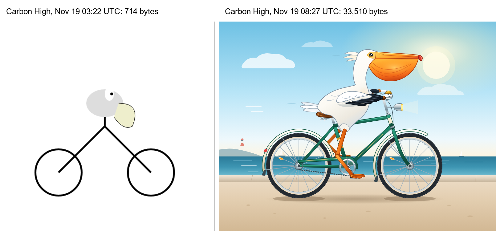

# Measuring an agent that stopped showing its thinking

*Case study, Google Antigravity, November 17–19, 2026. Written with the data from `agent-thinking-meter`.*

On November 17 my Antigravity agent started ending turns after one or two tool calls. Once it printed an SVG, said it was "executing", and stopped before writing the file. The model picker still showed Gemini 4 Carbon (High). Two days later it was back to normal. This is what the logs showed along the way.

## What I measured

Antigravity keeps each conversation on disk as JSONL. For every model step that called tools I looked at its output tokens and its thought summary. Placeholders such as "I'm thinking through how to approach this." are short, so I counted a summary as real when it is longer than 70 characters. This is a proxy for how often reasoning was surfaced in the transcript, not a measure of how hard the model reasoned internally.

## What changed

Standalone Gemini 4 Carbon (High), tool-call steps:

| Day (UTC) | Tool steps | Thought summary above cutoff | Avg output tokens | Median tool calls per turn |
|---|---:|---:|---:|---:|
| Nov 11 | 137 | 82.5% | 1,453 | 31 |
| Nov 13 | 452 | 73.9% | 1,594 | 37 |
| Nov 17 | 1,192 | 14.3% | 382 | 1 |
| Nov 18 | 400 | 17.5% | 305 | 1 |

The share began falling around 09:00 UTC on Nov 17 and reached 0–3% by mid-afternoon. The client version did not change during the drop. On the same day, 76.6% of Orchestrator (Carbon) tool steps still had a summary above the same cutoff, but selecting Orchestrator (Carbon) for a new task failed with `HTTP 400: Thinking level is unsupported: THINKING_LEVEL_XHIGH`.

## What others reported

On the [Google AI Developers Forum thread](https://discuss.ai.google.dev/t/counter-data-tool-aware-minimal-thinking-is-measurably-degrading-output-quality-on-agy-gemini-4-carbon/200671), youthfire saw a similar pattern from Nov 14 and ran an A/B with identical prompts against the subscription endpoint and the pay-as-you-go Gemini API. In their test the API version planned before tool calls, and the subscription version usually did not. Molly_Grey reproduced the pattern with a pelican-on-a-bicycle prompt. A Google engineer replied and asked us to update to v2.33.0 and report back.

## After the client update (Nov 19, 02:06 UTC)

1. New conversations defaulted to Gemini 4 Neon. Neon Medium had a summary above the cutoff on 0 of 9 tool steps, Neon High on 45% of 42.
2. On retest at 03:22 UTC, Carbon High wrote the SVG in three steps. The file was 714 bytes: two circles and a few lines. Orchestrator (Carbon) still failed at the hand-off from planning to execution with the same 400.

## Recovery (Nov 19, between about 03:30 and 08:00 UTC)

Later the same day, with no client change, behaviour came back:

* **Neon (High):** from 08:08 UTC, 10 of 10 tool steps carried a thought summary, averaging 851 output tokens, against 8 of 22 steps and 272 tokens earlier that morning in the same conversation.
* **Carbon (High):** the same pelican prompt in a fresh conversation produced a first step with a 21,349-character thought summary and 34,776 output tokens. The agent wrote a 33,510-byte SVG, rendered it, and inspected the image on its own. 9 of 12 tool steps carried a summary.
* **Orchestrator (Carbon):** the planner reasoned for about five minutes, then handed off to the execution worker without the 400. The worker wrote a 25 KB SVG and checked the render twice.



Since the fix arrived without a client update, it was most likely server-side. Thanks to the Antigravity team for the quick turnaround, and to youthfire and Molly_Grey for the data that helped narrow it down.

## What I took from it

* **Measure before you complain.** "It feels lazier" is easy to dismiss. "Tool steps with a thought summary fell from 82% to 14% on Nov 17 at 09:00 UTC, client unchanged" gives an engineer something to look for.
* **Keep the numbers privacy-safe.** Counts by day and model were enough for every post in the thread; no prompt, code or thought text had to leave the machine.
* **Report the recovery too.** A regression report is more useful when the same method also confirms the fix.

## Check your own logs

```bash
python agent_thinking_meter.py --source antigravity --since 2026-11-11
python agent_thinking_meter.py --source antigravity --by hour --since 2026-11-19 --until 2026-11-20
```

`agent-thinking-meter` also reads Claude Code and Codex CLI logs, where reasoning tokens are recorded directly. Compare a tool with itself over time; the measures differ between tools. If you see a similar drop, please share your numbers in the forum thread or open an issue here.
